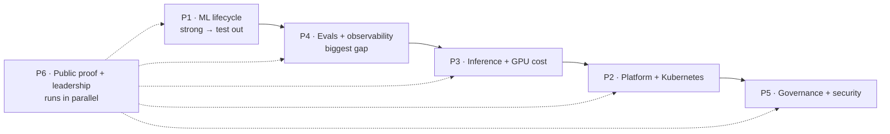

# AI Platform Mastery

A personal curriculum and learning app for becoming a **global-level AI/ML platform engineer**: someone who can design, run, evaluate and govern production AI systems, and whom other engineers learn from.

**6 pillars · 25 modules · ~190 hours · 96 readings · 144 quiz questions · 56 exercises · 6 capstones**



## How it works

| Step | What you do | Where |
|---|---|---|
| 1. Learn | Read the lesson (the core concepts, explained) | App, or `curriculum/<pillar>/<module>.md` |
| 2. Read | Do the **required** readings; optional ones go deeper | Readings table in each module |
| 3. Check | Take the quiz. **80% unlocks the next module** | App |
| 4. Build | Do the core exercises (stretch ones are optional) | Your own repos; link them in the app |
| 5. Reflect | Answer the reflection question in one paragraph | App notes |
| 6. Prove | Finish the pillar capstone, then write it up publicly | P6 |

Already strong in a module? Take the quiz first. If you pass, skim the lesson, do one exercise and move on.

## Repository layout

```
ai-platform-mastery/
├── content/            ← SOURCE OF TRUTH: one YAML file per pillar (lessons, readings, quizzes, exercises)
├── scripts/build.py    ← validates content and generates everything below
├── curriculum/         ← generated: one folder per pillar, one Markdown file per module
├── CURRICULUM.md       ← generated: full syllabus on one page
├── docs/
│   ├── how-to-study.md ← study method, weekly rhythm, 12-month plan
│   └── reading-list.md ← generated: every reading as a checklist
├── app/                ← progressive learning app (static, no build step)
│   ├── index.html
│   └── data/curriculum.json  ← generated
└── .github/workflows/  ← CI: validates content and checks generated files are up to date
```

## Editing content

1. Edit `content/pX-*.yaml`.
2. Run `python scripts/build.py` (needs `pip install pyyaml markdown`).
3. Commit both the YAML and the generated files. CI fails if they're out of sync.

Quiz options are shuffled at build time, so write the correct answer wherever you like.

## Using the app

A Coursera-style PWA: 6 illustrated courses, a 5-step lesson player (lesson → readings → quiz → exercises → reflect), graded quizzes that unlock the next module, capstones, certificates, badges, a review deck, an activity heatmap and active-time tracking.

- **Install it:** open the deployed URL on your phone. Android/Chrome shows an Install button; on iPhone tap Share → Add to Home Screen. It works offline once loaded.
- **Progress** is saved on the device in persistent storage. Use **Settings → Copy/Download backup** regularly, and restore on another device.
- **Locally:** `cd app && python -m http.server 8000`, then open http://localhost:8000
- `app/standalone.html` is a single-file build (no service worker) for sandboxed hosting.
- Deploys: the `app/` folder is a static site, with no build step. Run `python scripts/build.py` before committing so `data/curriculum.json` and `sw.js` are current.

## Start here

1. Read [docs/how-to-study.md](docs/how-to-study.md) (10 minutes).
2. Open the app and take the P1 test-out quizzes.
3. Start [P4 · Evals](curriculum/p4-evals-and-observability-for-llm-and-agent-systems/README.md).
